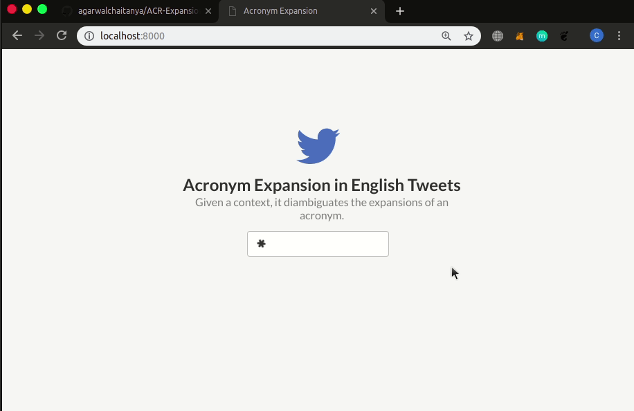

# ACR-Expansion-in-English-Tweets

Acronyms are present all across social media to express information that is repetitive and well known. But acronyms can be ambiguous because there can be many expansions of the same acronym. This project disambiguates between multiple expansions of an acronym given contextual information from a tweet.

For example, **"LOL"** could mean *laughing out loud*, *league of legends*, *lots of love*, or *little old lady*. Given a tweet like `"that joke had me LOL all night"`, the system predicts the intended expansion using machine learning.

## Demo



**Live app:** [https://secret-fjord-90750.herokuapp.com/](https://secret-fjord-90750.herokuapp.com/)

## How It Works

1. A user submits a tweet containing an acronym through the web interface
2. The text is preprocessed and converted to a vector representation using a pre-trained **Doc2Vec** model
3. A **Keras neural network classifier** specific to that acronym predicts the most likely expansion
4. The predicted expansion is displayed to the user

### ML Pipeline

The machine learning pipeline consists of three stages:

| Stage | Script | Description |
|-------|--------|-------------|
| Doc2Vec Training | `scripts/doc2vec.py` | Trains a Doc2Vec model on tweet data (vector size: 100) |
| Vector Inference | `scripts/build_vectors.py` | Generates vector representations for training/test data |
| Classifier Training | `scripts/build_classifiers.py` | Trains per-acronym Keras classifiers |

**Classifier architecture:** Dense(64) &rarr; Dropout(0.3) &rarr; Dense(128) &rarr; Dropout(0.3) &rarr; Dense(128) &rarr; Dropout(0.3) &rarr; Dense(64) &rarr; Dense(num_classes)

## Supported Acronyms

The system currently supports **28 acronyms** with a total of **68 possible expansions**:

| Acronym | Possible Expansions |
|---------|-------------------|
| brb | be right back, bathroom break |
| cc | carbon copy, i understand |
| dl | download, down low, doing laundry |
| eta | estimated time of arrival, edited to add |
| gf | girlfriend, gluten-free |
| gg | good game, good grief |
| gl | good luck, get lost |
| hoas | hold on a second, heck of a shot |
| hw | homework, hardware |
| ic | i see, in character |
| im | instant messenger, instant message |
| k | ok, kiss |
| lol | laughing out loud, league of legends, lots of love, little old lady |
| na | not available, not applicable |
| nc | no comment, nice call, not cool |
| nm | not much, nevermind |
| np | no problem, neopets |
| ot | off topic, other topic, overtime |
| pm | pm, private message |
| pos | parent over shoulder, piece of shit, power of suggestion |
| re | regarding, resident evil |
| rotfl | rolling on the floor laughing, rolling over freakin' laughing |
| smh | shaking my head, smash my head, scratching my head |
| sos | someone over shoulder, save our souls, same old stuff, someone special |
| tc | take care, that's cool |
| ur | your, you are |
| wb | write back, welcome back, way bored |
| y | why, yawning |

## Project Structure

```
ACR-Expansion-in-English-Tweets/
├── ACR/                        # Django project configuration
│   ├── settings.py             # Django settings
│   ├── urls.py                 # Root URL routing
│   └── wsgi.py                 # WSGI entry point
├── search/                     # Main Django app
│   ├── views.py                # View logic (prediction endpoint)
│   ├── urls.py                 # App URL routing
│   └── templates/search/
│       └── index.html          # Web interface
├── scripts/                    # ML training pipeline
│   ├── doc2vec.py              # Doc2Vec model training
│   ├── build_vectors.py        # Vector inference for train/test data
│   ├── build_classifiers.py    # Keras classifier training
│   └── classifier.py           # Alternative classifier implementation
├── classifiers/                # Pre-trained Keras models (.h5 files)
├── assets/                     # Static assets (demo GIF)
├── acrlist.py                  # Acronym-to-expansions dictionary
├── notebook.ipynb              # Jupyter notebook with analysis
├── requirements.txt            # Python dependencies
├── runtime.txt                 # Python version (3.6.7)
├── Procfile                    # Heroku deployment config
└── manage.py                   # Django management script
```

## Setup

### Prerequisites

- Python 3.6.7
- pip

### Installation

1. Clone the repository:
   ```bash
   git clone https://github.com/agarwalchaitanya/ACR-Expansion-in-English-Tweets.git
   cd ACR-Expansion-in-English-Tweets
   ```

2. Create and activate a virtual environment:
   ```bash
   python -m venv venv
   source venv/bin/activate   # Linux/macOS
   venv\Scripts\activate      # Windows
   ```

3. Install dependencies:
   ```bash
   pip install -r requirements.txt
   ```

4. Run database migrations:
   ```bash
   python manage.py migrate
   ```

5. Start the development server:
   ```bash
   python manage.py runserver
   ```

6. Open [http://127.0.0.1:8000/](http://127.0.0.1:8000/) in your browser.

### Training the Models

If you need to retrain the models from scratch (requires training data in `train_data/` and `test_data/` directories):

```bash
# 1. Train the Doc2Vec model
python scripts/doc2vec.py

# 2. Generate inferred vectors
python scripts/build_vectors.py

# 3. Train the classifiers
python scripts/build_classifiers.py
```

## Tech Stack

- **Web Framework:** Django 2.1.5
- **ML/NLP:** Gensim (Doc2Vec), Keras, TensorFlow
- **Data Processing:** NumPy, Pandas
- **Production Server:** Gunicorn
- **Deployment:** Heroku

## Deployment

The app is configured for Heroku deployment via the `Procfile`:

```
web: gunicorn ACR.wsgi --log-file -
```

To deploy your own instance:

```bash
heroku create
git push heroku master
```

## Notebook

Refer to [`notebook.ipynb`](notebook.ipynb) for data exploration and analysis of the acronym expansion task.

## To Do

- [x] Implement Search
- [x] Build Doc2Vec/BOW/TFIDF Models for Gensim Classifiers
- [x] Auto Deploy
- [ ] Containerize
- [ ] Host the Doc2Vec Model
